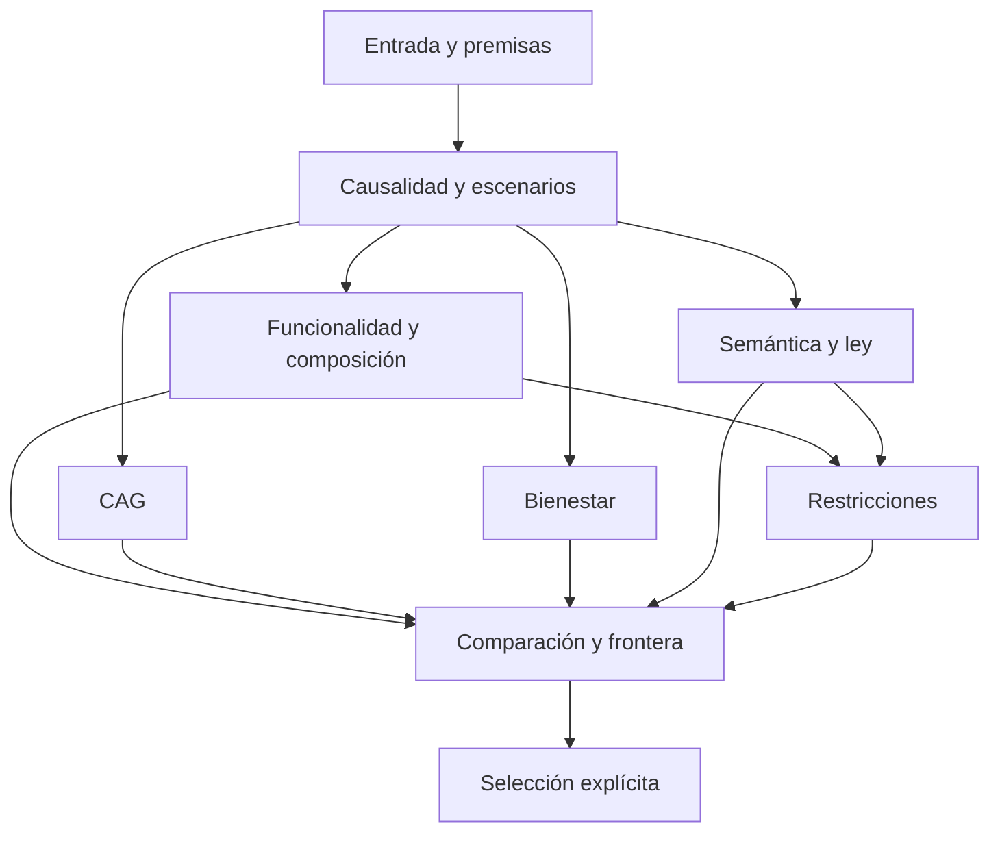

# Constructores, guardas y garantías

Normativo para GENIUS-SPEC-1.0.0. Este perfil fija el modo `pre` de MV: contexto y condición inicial comunes se fijan antes de elegir la política. El modo general `fix` no tiene representación en FP1. Las definiciones detalladas de 01–04 se aplican conjuntamente; una dependencia no satisfecha produce un registro diagnóstico, nunca un valor inventado.

## 1 DAG efectivo

La inicialización precede C. Los recursos pertenecen a F. El grafo representa dependencia de objetos, no orden obligatorio entre operaciones independientes. En particular, C no recibe CAG, tarea, presupuesto ni masas; G no recibe V ni la selección. Las premisas y tablas recibidas son inmutables. Ningún filtro de H reduce las hojas que utilizan G, W o E.

Cada constructor es función determinista sobre datos y registros diagnósticos. La implementación podrá ordenar tablas para presentación, sin convertir ese orden en preferencia. La salida matemática se compara como conjuntos y funciones finitas, salvo listas con orden semántico explícito. Un fallo o límite produce un registro tipado. El Teorema 10.1 acredita unicidad de los constructores matemáticos terminados, o de su propagación diagnóstica dado un registro de interrupción ya fijado; no promete que dos ejecuciones interrumpidas por tiempo exploren los mismos prefijos. Tampoco acredita por sí mismo que las fórmulas de un constructor sean correctas.

## 2 Procedimiento de referencia finito

1. Leer bytes y hash; comprobar sintaxis, tipos exactos, duplicados, referencias nominales, tiempos y variantes. Con error estructural no se emite ninguna conclusión matemática de la instancia. Conservar errores por ruta. No ejecutar contenido recibido.
2. Para cada π crear raíz (t=0,x0,i0,path=[]). Para cada ocurrencia con t<H leer π(t,i), conjuntos de acciones y la fila B(t,x,a). Exigir acción ejecutable y admisible, B no vacía y cada actualización U(t,i,a,y) definida. Crear UN hijo por resultado de la fila, conservando branch,u,x,y e información actualizada. Repetir hasta H. Una falla conserva el prefijo explorado y marca árbol incompleto; no convierte sus nodos abiertos en hojas completas. No deduplicar por x ni i.
3. Sobre cada árbol completo, obtener hojas, caminos, palabras u y correspondencia de escenarios. Exigir imagen exacta declarada y fibras singleton. Un árbol completo con fibra múltiple sigue siendo un árbol causal legítimo, pero queda fuera del bloque fuerte FP1 que usa esos escenarios.
4. Sea P la unión de puntos (t,x) efectivamente alcanzados de todos los árboles completos. Validar tablas sobre Query contra los árboles. Obtener MI en P, calibraciones comunes y suficiencia ψ; obtener Rπ, sus proyecciones y join; sumas de recursos por consulta. Mantener cada fallo de guarda separado del dominio de un número tabulado. No usar ψ para reemplazar el árbol.
5. Calcular identidad nativa, traducción, significados y guardas de conservación; evaluar receta sobre cada traza traducida completa; después unir o intersectar según mode. Calcular origen, CAG, adicional y testigos. Una pérdida en acc no autoriza dejar de comprobar las identidades posteriores requeridas.
6. Calcular historia de bienestar de cada hoja usando las celdas de cada prefijo y el soporte global. Formar el perfil por escenario, tiempo, portador y dimensión. Comprobar todas las celdas requeridas, incluso si ya apareció una desigualdad desfavorable en otro criterio.
7. Calcular L(h) de cada consulta desde el árbol; Sem(h) solo con cobertura total de Jtask. Evaluar D* y emitir certificado canónico donde proceda. Validar TODAS las filas de ley presentes y propagar masas racionales; hojas nulas permanecen. Formar VProb si existe ley, PVS si además M?=0.
8. Evaluar cada restricción declarada por cobertura completa positiva o por testigo negativo. Clasificar Afeas, Afail, Aunk. No suprimir otros diagnósticos cuando un testigo decide H=0.
9. Obtener bloque B y C según §4; comparar los cuatro criterios en todos los pares de B, con dominios comprobados antes de comparar. Obtener estricta y frontera de C; conservar dominadores para las excluidas y cobertura completa de pares para las maximales.
10. Determinar cobertura EXHAUSTIVE si y solo si todas las guardas de §3 pasan. Después ejecutar la regla de selección únicamente con esa cobertura y su dominio satisfecho. Comprobar SELECTION (también que la ausencia de selección sea correcta); emitir certificado fuerte con G01–G15 y ese chequeo PASS. Devolver resultado y expediente verificable de 06. G15 no depende de selección; así no hay ciclo entre cobertura y selector.

No se infiere un conjunto P completo desde una exploración truncada. Si algún árbol objetivo queda incompleto, puede certificarse un alcance local explícito sobre los árboles completos, pero FSuff global sobre P objetivo y la integración completa quedan sin acreditar. Un chequeo local nunca se promociona al alcance total sin nueva cobertura.

## 3 Obligaciones de la ruta fuerte

Todas las guardas se comprueban sobre TODA Π, incluidas políticas que luego resulten infactibles. Un certificado fuerte afirma precisamente esta conjunción:

| Guarda | Obligación comprobable | Dependencia de la teoría |
|---|---|---|
| G01 | Presentación estructural válida, variantes FP1, premisas identificadas y congeladas | Definiciones y dominios generales |
| G02 | Inicialización singleton formal compartida; alcance condicional a su basis | M0, MV 7.1 |
| G03 | Árbol completo no vacío a H para cada π; decisiones por información, cobertura de B y U | MV 7.2–7.4 |
| G04 | Mismas palabras exógenas Xi no vacías; una y solo una hoja por (π,xi) | 10.2; restricción explícita frente a MV general |
| G05 | Perfil funcional total en P, calibraciones que preservan/reflejan orden, índice fijo | MI 3.1–3.4 |
| G06 | ψ cubre Df, dominio saturado y valores constantes en fibras sobre P completo | M0 2.1, especialización funcional |
| G07 | Una fila R por consulta y join de todas las proyecciones exactamente Rπ, sin mezclar π | MII 4.3–4.6 |
| G08 | Toda demanda requerida definida en toda consulta; unidades comunes y suma por identidad | MII Def4.6/Prop4.5; totalidad necesaria para certificar recursos |
| G09 | Origen y trazas de identidad completas; significados fieles, preórdenes y transporte requerido; receta común | MIII 5.1–5.6 |
| G10 | Reloj 0..H y soporte común; todas las celdas aplicables de bienestar definidas | MIV 6.1–6.7 |
| G11 | Tablas semánticas válidas; protocolo exacto con clausura de admisión canónica; V parcial calculado exactamente | MVI 8.3–8.6, AM-02 |
| G12 | Ley válida y completa; VProb exacto y M?=0 en cada π, por tanto PVS definida | MVI 8.7–8.9 |
| G13 | Cada H_j de cada π decidido por verificación; partición exacta respecto de lista declarada | MVII Def9.3–9.4 |
| G14 | Cuatro valoraciones completas y compatibles; todos los pares y sus índices conservados | MVII Teo9.2 |
| G15 | C=Afeas, frontera por estricta sobre todo C y cobertura del objetivo Π | MVII Teo9.3–9.4 y definición de selector |

G11 no exige que V esté definido en todos los prefijos, ni que todas las hojas tengan valor. G12 permite V indefinida en hojas de masa cero. Una restricción task_all puede imponer condiciones adicionales; no se añade implícitamente. G13 no implica G08: un exceso conocido puede decidir una restricción aunque falte otra demanda. La ruta fuerte exige ambas.

Los tests de tipo/cobertura son evidencia interna; las afirmaciones causales, empíricas, semánticas y normativas de basis permanecen premisas. Una certificación fuerte se denomina **condicional de instancia formal**, nunca validación de esas premisas contra el mundo.

## 4 Bloque parcial, comparación y alcance

Para evitar elegir índices por cada par, B se define de forma única: todas las políticas de Π con árbol completo, correspondencia a Xi verificada, cuatro valoraciones completas y guardas de comparabilidad comunes acreditadas. Para funcionalidad basta su perfil terminal completo y calibración válida sobre el ámbito alcanzado completo de esas políticas; para CAG rigen todas sus guardas; para bienestar todo su soporte histórico; para PVS su propia guarda. ψ, join, totalidad de recursos o hard pueden fallar sin borrar esas valoraciones. Sus fallos impiden certificado fuerte.

Sea B0 el conjunto de políticas con árbol y escenarios acreditados y datos individuales completos para los cuatro criterios antes de comprobar guardas comunes. En caso de calibración o transporte compartido, la guarda se comprueba sobre la unión de los ámbitos de B0; si falla no se elige arbitrariamente un subgrupo favorable: se excluye del bloque a TODAS las políticas dependientes de ese componente compartido y se informa el testigo. Los preórdenes generativos declarados se comprueban siempre sobre el alfabeto completo. No existe una búsqueda oculta del mayor bloque compatible.

C=B∩Afeas. La frontera de C se calcula exactamente cuando sus comparaciones están disponibles. Etiqueta EXHAUSTIVE solo si G01–G15 están PASS para toda Π; en otro caso, RELATIVE con omisiones y guardas fallidas. Esta regla es deliberadamente conservadora: una frontera matemáticamente completa por otras razones no recibe aquí la etiqueta fuerte sin demostrar otra ruta versionada. Si C es vacío y ruta fuerte pasa, la frontera EXHAUSTIVE vacía certifica ausencia de factibles en Π; si el alcance es parcial, frontera vacía no certifica infactibilidad global.

Si no hay B por entradas inválidas o ejecución incompleta, el diagnóstico distingue bloqueo de cálculo de un conjunto B matemáticamente vacío. Una implementación puede calcular un bloque ya certificado tras agotar presupuesto, pero deberá denominarlo alcance computacional parcial, nunca el B máximo de esta definición ni selección global. La salida mínima requerida ante agotamiento es LIMITED sin decisión.

## 5 Garantía y efectividad

Bajo G01–G15, cada módulo entrega su objeto en el dominio declarado; las claves compartidas identifican las mismas políticas, escenarios y consultas; las dependencias acíclicas permiten componer los resultados. La intersección de los preórdenes componentes conserva reflexividad y transitividad mediante conjunción; su estricta produce la frontera finita; una regla de selección explícita opera únicamente en su dominio. Esta es la instanciación acotada de 10.2, con la reparación de 8.6 y los dominios explicitados en S2. Véanse las cuatro revisiones deductivas, no solo esta descripción.

La terminación ideal de 10.3 aquí no se basa en «los datos son finitos» por sí solo: los únicos procedimientos son enumeración de tablas, expansión acotada por H, joins de relaciones finitas, sumas/comparaciones enteras, cierres y chequeos de matrices finitas, intersecciones y comparación de pares. Si b es la mayor longitud de outcomes, cada árbol tiene a lo sumo sumatorio de b^t, t=0..H (incluye b=0 y H=0); todos los demás productos y conjuntos de búsqueda son finitos y explícitos. No se invoca programa u oráculo arbitrario. El coste puede ser exponencial y no se promete rapidez práctica.

El presupuesto del programa (tiempo, memoria, cantidad de nodos, tamaño de enteros) se declara en configuración operativa, fuera de Instance y de las restricciones del problema. Un límite devuelve LIMITED y cobertura procesada, no altera H, Π, el modelo, probabilidades ni constraints. Fallo interno devuelve ERROR. Ninguno prueba estar fuera del dominio matemático, infactibilidad ni inexistencia de solución.

F1 define este procedimiento y sus casos; F2 debe implementarlo y ejecutar conformidad. No existe todavía prueba de corrección de un código Kernel, benchmark ni validación externa.
